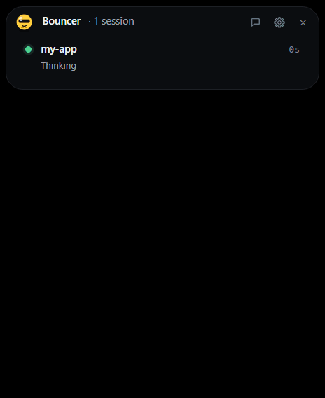

# Bouncer

**The security guard for coding agents.** A free, open-source desktop
companion for Claude Code: it watches your sessions, lets safe actions
through under rules you control, stops risky ones at the door with a plain
reason, and never blocks the agent.



- **Sessions in an island.** Every Claude Code session, live, in a small
  island at the top of the screen.
- **Approve or deny.** Claude Code's permission requests show up as cards:
  the whole command, hidden characters made visible, edits as a diff. Allow
  arms after 600 ms, the keyboard starts on Deny, and Enter never approves.
- **Auto-allow by rule.** Rules you write (or add with "Always allow…") answer
  for you in auto mode; observe mode only says what they would do.
- **Risky flags.** Requests that download and run scripts, delete outside the
  project, touch secrets, force-push and so on are flagged with a plain
  reason and never auto-allowed. Compound or unparseable commands always ask.
- **Questions and plans.** When Claude Code asks you to pick an option or
  approve a plan, the island shows it too: pick and send, or approve / keep
  planning. Only your click answers; the terminal asks at the same time, and
  whichever you answer first wins.
- **Explain this command.** One click asks Claude what a shell command does
  and what could go wrong.
- **Read-only chat.** Ask Claude a question from the island, through your
  own Claude Code, locked to read-only.
- **Redacted log.** A local activity log with secrets removed before
  anything is written, and a summary when you come back.
- **Fail-safe.** If Bouncer is closed, slow or confused, Claude Code asks in
  its own prompt as usual. Nothing is ever allowed by default.
- **Updates on your click.** Once a day Bouncer looks for a newer release;
  it installs only when you click **Update** (and never mid-decision). Turn
  the check off in Settings.

**Status:** Windows 10 and 11 (64-bit). v0.7.0 is the first release; no Mac
build yet.

## Install

1. Download `Bouncer_<version>_x64-setup.exe` and `SHA256SUMS.txt` from
   [Releases](https://github.com/charanp11/bouncer-app/releases).
2. Check the file is the one GitHub built. In PowerShell, in your Downloads
   folder:

   ```powershell
   Get-FileHash .\Bouncer_0.7.0_x64-setup.exe
   ```

   The hash must match the line in `SHA256SUMS.txt`. With the
   [GitHub CLI](https://cli.github.com/) you can also check that it was built
   by this repo's release workflow from its tag:

   ```powershell
   gh attestation verify .\Bouncer_0.7.0_x64-setup.exe --repo charanp11/bouncer-app
   ```

3. Run it. Bouncer isn't code-signed yet, so Windows SmartScreen says
   **"Windows protected your PC"** with an unknown publisher: click
   **More info**, then **Run anyway**. Edge may also say the file "isn't
   commonly downloaded": choose **Keep**. It installs for your user only
   (`%LOCALAPPDATA%\Bouncer`), with no admin prompt. If WebView2 is missing,
   the installer downloads it from Microsoft. The app's only network use is
   the daily update check (see [Privacy](#privacy)).
4. In Bouncer, open Settings (the gear) → **Claude Code hooks** →
   **Install…**. It shows the exact change to `~/.claude/settings.json`;
   **Write changes** saves it, with a dated backup beside the file. Claude
   Code sessions started after this show up in the island.

**Smart App Control.** If it's on (Windows 11, Windows Security → App &
browser control), it blocks unsigned apps with no "Run anyway". Bouncer
can't be installed until it's signed, unless you turn Smart App Control
off (your call: Windows may not let you turn it back on without a reset). Signing is
planned (SignPath Foundation).

**Microsoft Defender.** New unsigned apps are sometimes flagged by mistake.
Check the hash and the attestation above first; if they match and Defender
still flags it, please
[open an issue](https://github.com/charanp11/bouncer-app/issues) and
[report the false positive to Microsoft](https://www.microsoft.com/en-us/wdsi/filesubmission).

## Update

From 0.8.1, Bouncer updates itself, but only when you say so. Once a day it
checks for a newer release; when there is one, the island's session list
shows **"Bouncer X.Y.Z is ready"** with an **Update** button. Click it:
Bouncer downloads the installer, checks its signature (made by this repo's
release workflow with the project's updater key), then runs it with a small
progress bar and starts again. Your hooks, rules, settings and history stay;
it never asks about the hooks. While a card or question is waiting, or a
chat or explanation is running, the button says **Update after you answer**
and waits, so Bouncer never quits in the middle of a decision. If anything
goes wrong (offline, GitHub down, a bad signature), nothing is installed and
nothing nags you; it tries again the next day.

**Coming from 0.7.0?** It has no updater: install 0.8.1 by hand once
(download it and run it as in [Install](#install); everything stays).

**By hand.** You can always download the new installer and run it yourself
(check it the same way). It closes Bouncer and replaces it in place.

**An email when a release comes out:** on the
[GitHub page](https://github.com/charanp11/bouncer-app), **Watch → Custom →
Releases**.

## Uninstall

Settings → Apps → Installed apps → Bouncer → Uninstall.

- **The hooks.** A console window shows what would be removed from
  `~/.claude/settings.json` and asks `[y/N]`. **y** removes only Bouncer's
  entries (dated backup first). **N**, the default, keeps them: answer N if
  you're installing Bouncer again next. Kept hooks point at a program that's
  gone, so Claude Code shows a hook error on each event and carries on,
  asking in its own prompt; remove them later from a reinstalled Bouncer, or
  by hand.
- **"Delete the application data".** Unticked by default: your rules,
  settings and history (`%APPDATA%\Bouncer`) stay for next time. Ticked, that
  folder and Bouncer's WebView2 data folder are deleted. Nothing else is.

## Where it works

| Where you run Claude Code | Bouncer |
| --- | --- |
| A terminal (`claude`) | Yes |
| The VS Code extension | Yes |
| The Claude desktop app's Code tab | Yes |
| Claude Code on the web (cloud) | No: it runs on Anthropic's servers, so its hooks can't reach your PC |

All three local ones read the hooks in `~/.claude/settings.json`. In VS Code
and the desktop app, Bouncer's card shows up next to the app's own
permission prompt: answer in either. Answer in the island and the app's
prompt closes; answer in the app and the card stays until Claude Code moves
on. Cards come only when Claude Code asks, so the permission mode matters:
see the first item under "What it can't do".

## What it can't do

- **It can only approve or deny when Claude Code asks.** In
  bypass-permissions mode Claude Code never asks, and in auto mode it rarely
  does, so Bouncer mostly watches. Accept-edits mode doesn't ask before file
  edits or file commands such as `mkdir`, but still asks before other
  commands, and those get a card. For a card on everything, use default mode
  (`claude --permission-mode default`). Or turn on Settings → **Guard every
  mode** (off by default): then a risky request in auto, accept-edits or
  bypass mode stops for Claude Code's prompt and Bouncer's card instead of
  running. In a `claude -p` run, which can't show a prompt, it's refused
  instead. Safe requests in those modes still run unasked, and Bouncer never
  allows or denies anything on its own.
- **Only Claude Code for now.** Other agents come one per release.
- **Some questions stay in the terminal.** Typing your own answer ("Type
  something"), questions Bouncer can't show unambiguously (for example a
  multi-select option whose label contains ", "), and any question while
  Bouncer is paused are answered in Claude Code only; the island says the
  session waits.
- **Approving a plan keeps the mode you had.** Approving a plan in the
  island returns the session to the permission mode it had before plan
  mode; Bouncer never sets it. If that was bypass, it's bypass again. To
  approve and switch modes (for example to accept edits or auto), answer in
  Claude Code's own prompt.
- **It never blocks the agent.** If Bouncer is closed, paused, slow or
  confused, Claude Code asks in its own prompt as usual. A card waits 100
  seconds, then goes, and Claude Code asks.
- **Rules can't make an unsafe command safe.** A rule only allows what it
  matches; risky and compound commands still ask. What you allow runs with
  your permissions.
- **Explanations can be wrong.** "Explain this command" is Claude's reading,
  not a verdict. You decide.
- **Not signed yet.** See SmartScreen and Smart App Control above.
- **No Mac build yet.** The code runs on macOS in CI, but there's no
  release for it.

## Chat

Ask Claude a question from the island: the chat button next to the gear in
the session list opens it.

- **It runs your own Claude Code** (`claude -p`, signed in as you). Each
  message counts against your Claude plan's usage, like any Claude Code
  message; the panel shows your plan's 5-hour and 7-day use. Bouncer never
  reads, stores or passes an API key, and a run that isn't on your Claude
  login is stopped.
- **It's read-only.** A chat can only Read, Grep and Glob inside its own
  empty folder. It can't edit or write files, run commands, use the web,
  your MCP servers or connectors, or your Claude Code settings and hooks.
- **Nothing is kept.** Chats live in memory only: no history, no transcript.
  Cancel, a 5-minute limit per message, or quitting Bouncer stops Claude Code
  and everything it started.
- **First, confirm which `claude` it runs.** The first time, the panel shows
  the full path of the Claude Code it found (a native `claude.exe`, or
  `claude` on macOS; npm's `.cmd` / `.ps1` shims are never run). Open
  Settings → **Claude Code for chat**, check the path, and click **Confirm
  this path**. If that path ever changes, Bouncer asks again before any chat
  runs.
- **Explain this command.** A card for a shell command (Bash, PowerShell)
  has an **Explain this command** button: the same locked chat says what the
  command does and what could go wrong. It can be wrong and never decides:
  Deny and Allow work as always while it answers, and it stops when the card
  is answered or goes.

## Privacy

No telemetry. Bouncer makes exactly one kind of network request: the
daily update check. Once a day (the first a minute after it starts) it
fetches
`https://github.com/charanp11/bouncer-app/releases/latest/download/latest.json`,
a small file naming the latest published version and its installer's
signature. The request carries a generic user agent
(`tauri-plugin-updater/<version>`) and nothing else: not your Bouncer
version, your machine, your sessions or anything you did. GitHub sees your IP
address, as with any download. Only when you click **Update** is the
installer downloaded. Turn it off in Settings → **Check for updates**: then
Bouncer makes no network requests at all. (Development builds never check.)
Everything else stays on your machine. What you send in a chat or an explanation goes to Claude
through your own Claude Code, as any Claude Code message does. The activity
log keeps no tool output or file contents, and secrets are removed before
anything is written.

## Building from source

Needs Rust (stable) and Node.js 24.

```sh
npm ci
npm run tauri dev
```

## License

[MIT](LICENSE). Security issues: see [SECURITY.md](SECURITY.md).
